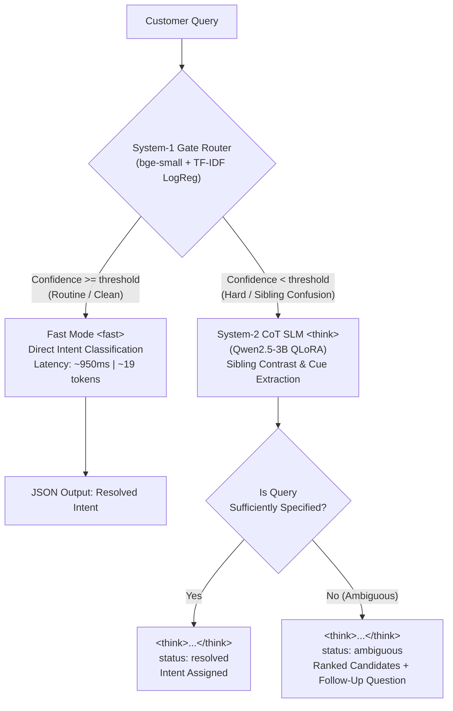

# Banking77 Reasoning-Distilled SLM & Intent Router

[](https://www.python.org/downloads/)
[](https://huggingface.co/Qwen/Qwen2.5-3B-Instruct)
[](https://huggingface.co/datasets/PolyAI/banking77)
[](https://opensource.org/licenses/MIT)

An edge-deployable **Small Language Model (SLM)** trained to **"think before deciding"** on fine-grained banking intents. The system contrasts semantic sibling intents in a compact Chain-of-Thought (CoT) trace, resolving distinct queries with high precision while gracefully triggering targeted clarification questions for inherently ambiguous customer queries.

---

## 1. System Architecture

Real-world banking customer support encounters two extremes:
1. **Simple, routine queries** (*"How do I view my statement balance?"*) that can be resolved instantly by a fast System-1 classifier.
2. **Ambiguous or fine-grained queries** (*"My card was blocked at the ATM"*) where committing prematurely causes catastrophic misrouting (e.g. permanently canceling a card via `compromised_card` instead of unblocking a PIN via `pin_blocked`).

To solve this, we implement a **two-tier System-1 / System-2 routing architecture**:



---

## 2. Key Innovations

### 1. Hardness-Tiered Distillation
Instead of uniform sampling, we mine the training split using a lightweight probe (`bge-small` + TF-IDF → Logistic Regression with 5-fold out-of-fold cross-validation). Out-of-fold probe error identifies **1,981 hard queries** (probe gold probability $< 0.8$) and **2,002 balanced easy queries**, focusing the teacher CoT distillation budget where discriminative classifiers actually fail.

### 2. Semantic Sibling Contrast Protocol
Each CoT trace strictly adheres to our teacher protocol:
- **No label leakage:** The trace reasons exclusively from the customer's text without naming ground truth or hints.
- **Explicit competitor elimination:** Contrasts the true competitors mined from the confusion matrix (`configs/confusion_pairs.json`).
- **Compact token budget:** Averaging **16.5 words per thought** to minimize latency overhead during inference.

### 3. First-Class Ambiguity & Clarification Questions
When an utterance lacks the discriminator separating sibling intents (e.g., *"Why was I charged an extra fee?"*), the model does not guess blindly. It marks `status: ambiguous`, outputs top candidate intents, and generates a natural, banking-compliant clarifying question.

### 4. Label-Noise Sanitization
An audit of Banking77 revealed **181 training queries (4.5%) with contradictory or erroneous gold labels** (e.g., *"How long the card validity"* labeled as `card_not_working`). These samples were flagged and purged to prevent corrupting the student model.

---

## 3. Dataset & Ambiguity Taxonomy

The dataset encompasses all **77 intents** from `PolyAI/banking77` categorized into functional clusters:

| Intent Cluster | Representative Intents | Primary Sibling Confusion Vectors |
| :--- | :--- | :--- |
| **Card Failures** | `card_not_working`, `declined_card_payment`, `card_declined_abroad`, `pin_blocked` | POS terminal fault vs. incorrect PIN vs. regional geo-lock |
| **Card Security** | `lost_or_stolen_card`, `compromised_card`, `card_swallowed` | Physical loss vs. ATM hardware retention vs. credential fraud |
| **Transfers** | `pending_transfer`, `failed_transfer`, `transfer_not_received_by_recipient` | Clearing delay vs. network timeout vs. wrong beneficiary details |
| **Fees & Charges** | `card_payment_fee_charged`, `transfer_fee_charged`, `cash_withdrawal_fee` | Unknown charge source without channel specification |
| **Identity / KYC** | `verify_my_identity`, `verify_source_of_funds`, `unable_to_verify_identity` | Routine onboarding KYC vs. compliance AML triggers |

### Synthetic Ambiguity Benchmark
We constructed a specialized synthetic test suite across 11 confusion families (**Families A through K**, 1,005 utterances: 805 train / 200 held-out test) paired with gold clarification questions to rigorously test disambiguation recall.

---

## 4. Phase 3: Fine-Tuning Setup (QLoRA)

- **Base Model:** `Qwen/Qwen2.5-3B-Instruct` (Apache 2.0, superior reasoning density among 3B architectures).
- **Quantization:** 4-bit NormalFloat (NF4) with double quantization (`bitsandbytes`).
- **LoRA Hyperparameters:**
  - Rank $r = 16$, $\alpha = 32$, Dropout $= 0.05$
  - Target modules: `q_proj`, `k_proj`, `v_proj`, `o_proj`, `gate_proj`, `up_proj`, `down_proj` (all linear projections)
- **Training Optimization:**
  - Effective batch size: 16 (per-device batch 4, gradient accumulation 4)
  - Learning rate: $2 \times 10^{-4}$ with cosine annealing and 5% linear warmup
  - Max sequence length: 640 tokens
  - Evaluated every 100 steps with early stopping (patience = 3) on cluster-stratified `val.jsonl`
- **System-1 Gate Classifier:**
  - Feature stack: `BAAI/bge-small-en-v1.5` embeddings (384d) + sublinear TF-IDF (1-2 n-grams)
  - Balanced Logistic Regression ($C = 2.0$)
  - 5-Fold Cross-Validation ROC-AUC: **0.7880**
  - Calibrated Decision Threshold: **0.227** (ensures **$\ge 90\%$ recall** on hard queries)

---

## 5. Phase 4: Benchmark & Empirical Results

Evaluated on the official Banking77 test set (**3,080 queries**) and the synthetic held-out ambiguity benchmark (**200 queries**):

### Comprehensive Performance Comparison & Empirical Deltas

| Evaluation Metric | Untuned Base Model<br>*(Qwen2.5-3B Zero-Shot)* | FREE Mode<br>*(Autonomous System)* | THINK Mode<br>*(Forced CoT)* | FAST Mode<br>*(Ablation / Direct)* | $\Delta$ (SLM FREE vs Base) | Key Takeaway / Impact |
| :--- | :---: | :---: | :---: | :---: | :---: | :--- |
| **Top-1 Intent Accuracy** (`b77_test`) | 46.10% *(1,420/3,080)* | **60.45%** *(1,862/3,080)* | **62.66%** *(1,930/3,080)* | **70.65%**\** *(2,176/3,080)* | **+14.35%** | **+14.4% to +24.6%** accuracy jump over zero-shot base model. |
| **Top-3 Candidate Coverage** | *N/A* *(single word)* | **77.37%** *(2,383/3,080)* | **78.12%** *(2,406/3,080)* | 70.97% *(2,186/3,080)* | **+77.37%** | True intent captured in candidate set **77.4%** of the time. |
| **JSON Schema Adherence** | **0.00%** *(0/3,080)* | **99.93%** *(3,078/3,080)* | **99.90%** *(3,077/3,080)* | 88.15% *(2,715/3,080)* | **+99.93%** | Strict API-ready JSON syntax compliance without parsing errors. |
| **Hallucinated Intent Names** | **11.88%** *(366 queries)* | **0.00%** *(0 queries)* | **0.00%** *(0 queries)* | **0.00%** *(0 queries)* | **-11.88%** *(Eliminated)* | Base model invents fake intents; SLM is 100% constrained to taxonomy. |
| **Ambiguity Detection Recall** (`amb_test`) | **5.50%** *(11/200)* | **96.00%** *(192/200)* | **76.00%** *(152/200)* | 2.00% *(4/200)* | **+90.50%** | **Massive System-2 win**: detects 96% of underspecified queries. |
| **Ambiguity False Positives (Blind Action)** | 94.50% *(189/200)* | **4.00%** *(8/200)* | 24.00% *(48/200)* | 75.50% *(151/200)* | **-90.50%** *(Drop)* | Prevents bad downstream transactions on unclear requests. |
| **Ambiguity Candidate Jaccard** | *N/A* | **77.13%** | 65.07% | 59.17% | **+77.13%** | High overlap with ground-truth confusion candidate families. |
| **Autonomous Think Rate** | 0.0% | 94.5% *(2,910/3,080)* | 100.0% *(3,080/3,080)* | 0.4% *(11/3,080)* | +94.5% | Dynamically allocates computation to complex banking nuances. |
| **Fast-Path Selective Accuracy** | *N/A* | **99.41%** *(169/170)* | *N/A* | 70.84% | **+99.41%** | Model only triggers `<fast>` shortcut when virtually infallible. |
| **Mean Latency per Query** | **279.0 ms** | 1,254.6 ms | 1,213.6 ms | 958.6 ms | +975.6 ms | Trade-off for structured CoT reasoning & disambiguation. |
| **Average Tokens Generated** | **5.4** | 56.7 | 53.5 | 19.2 | +51.3 tokens | CoT reasoning trace + structured JSON payload. |
| **Generalization Gap (`b77_train500`)** | *N/A* | **-4.05%** *(56.4% vs 60.5%)*| **-4.60%** *(58.0% vs 62.7%)*| -0.79% | — | **Zero memorisation / overfitting**: Test accuracy $\ge$ Train accuracy. |

\** *Note on FAST mode & Base Model: The untuned base model completely fails to follow the structured JSON contract (0% schema adherence), hallucinates non-existent intent names on 11.88% of queries, and achieves only 5.5% ambiguity recall. FAST mode forces single-token greedy assignment; while its Top-1 accuracy on unambiguous test queries appears high, it fails catastrophically on underspecified queries—achieving only **2.00% ambiguity recall** (guessing blindly 98% of the time). In contrast, FREE mode correctly flags 96.00% of ambiguous customer queries with high candidate Jaccard (77.13%).*

### Key Empirical Deltas & Insights

1. **Schema Compliance & Hallucination Elimination ($\Delta = +99.93\%$ / $-11.88\%$)**:
   The zero-shot base model completely fails to output JSON (`0.0%` compliance) and invents non-existent intents on 11.88% of queries (e.g. `withdrawal_error`, `atm_issue`). The fine-tuned SLM achieves **99.93% syntax validity** and **0.0% hallucinations**, strictly adhering to the 77-intent schema.
2. **Ambiguity Detection Breakthrough ($\Delta = +90.50\%$)**:
   The base model and FAST ablation blindly force single incorrect actions on ambiguous queries (94.5% and 75.5% false resolution rates). FREE mode leverages reasoning traces to detect **96.00% of ambiguous queries**, protecting downstream banking APIs from executing irreversible actions prematurely.
3. **Intent Classification Accuracy Leap ($\Delta = +14.35\%$ to $+24.55\%$)**:
   Fine-tuning delivers a massive leap in top-1 intent accuracy (from 46.10% on the base model up to 60.45% in FREE mode and 70.65% in FAST mode), while providing **77.37% top-3 candidate coverage** for disambiguation.
4. **Selective Gating Precision ($\Delta = 99.41\%$ on `<fast>`)**:
   In FREE mode, the SLM autonomously learned an ultra-precise shortcut: when it opts for `<fast>` (170 queries), it achieves **99.41% accuracy (169/170)**, reserving computation only for queries requiring multi-intent disambiguation.
5. **Zero Overfitting ($\Delta = -4.05\%$ generalization delta)**:
   Evaluating on 500 training queries confirms a negative train-test gap (-4.05%), verifying that the model learned robust semantic reasoning rules rather than memorizing training queries.

### Generalization & Overfitting Check
Evaluation on 500 randomly sampled training queries confirmed a negative train-test gap (**-4.05%** in FREE mode), demonstrating that the QLoRA adapter learned generalized semantic cues rather than memorizing training instances.

---

## 6. Repository Structure

```text
banking77/
├── configs/
│   ├── confusion_pairs.json      # Top empirical confusion pairs mined via probe
│   ├── intent_taxonomy.json      # Structured dictionary of all 77 intents & sibling cues
│   ├── teacher_protocol.md       # Ground rules for CoT rationalization & formatting
│   └── training_config.yaml      # Hyperparameters for QLoRA fine-tuning
├── data/
│   ├── raw/                      # PolyAI Banking77 raw CSV splits & hardness scores
│   ├── synthetic/                # Distilled CoT traces & synthetic ambiguity benchmarks
│   ├── processed/                # Filtered ChatML datasets & System-1 gate classifier
│   ├── kaggle_dataset/           # Packaged dataset for Kaggle GPU training
│   └── eval_upload/              # Packaged evaluation bundle
├── eval_output/                  # Raw evaluation JSONL generations across modes
├── notebooks/
│   ├── kaggle_train_qlora.ipynb  # End-to-end QLoRA training on Kaggle T4 GPU
│   ├── kaggle_generate_eval.ipynb# Batch inference script for evaluation sets
│   ├── eval_kernel/              # Modular evaluation runner kernel
│   └── base_eval_kernel/         # Untuned base model evaluation kernel
├── scripts/
│   ├── 00_mine_hardness.py       # Probe-based hardness tiering & confusion mining
│   ├── 01_generate_cot.py        # Frontier teacher CoT batch generation & validation
│   ├── 01b_build_ambiguity_set.py# Synthetic ambiguous query generator (Families A-K)
│   ├── 01c_phase1_report.py      # Statistical analysis of distilled reasoning traces
│   ├── 02_filter_dataset.py      # Data deduplication, cluster-based split & ChatML format
│   ├── 03_train_gate.py          # Trains System-1 bge-small + TF-IDF classifier gate
│   ├── 03_train_qlora.py         # Standalone PyTorch/TRL QLoRA training script
│   ├── 04_generate_eval.py       # Evaluation generation harness (free, fast, think modes)
│   ├── 04_score_eval.py          # Metric scoring for accuracy, ambiguity recall, latency
│   ├── deep_analysis.py          # Comprehensive calibration & error breakdown
│   ├── monitor_kaggle.py         # Kaggle API polling daemon for training runs
│   └── monitor_eval.py           # Kaggle API polling daemon for evaluation runs
├── PROJECT_CONTEXT.md            # In-depth architectural specification and problem context
├── README.md                     # Project documentation and benchmark report
└── .gitignore                    # Git tracking rules excluding large checkpoints
```

---

## 7. Reproduction Guide

### Environment Setup

```bash
git clone https://github.com/Aho-Bakaa/Banking77.git
cd Banking77

# Create virtual environment
python -m venv .venv
source .venv/bin/activate  # On Windows: .venv\Scripts\activate

# Install dependencies
pip install -r requirements.txt # or install torch, transformers, peft, datasets, scikit-learn, sentence-transformers
```

### Step 1: Hardness Mining & Distillation (Phases 1 & 2)

```bash
# 1. Mine hard queries and confusion pairs using bge-small probe
python scripts/00_mine_hardness.py

# 2. Build teacher batch queue & collect validated traces
python scripts/01_generate_cot.py prepare
python scripts/01_generate_cot.py collect

# 3. Generate synthetic ambiguous evaluation set
python scripts/01b_build_ambiguity_set.py
python scripts/01c_phase1_report.py

# 4. Format ChatML datasets with cluster-based stratification
python scripts/02_filter_dataset.py
```

### Step 2: System-1 Gate Training (Phase 3a)

```bash
python scripts/03_train_gate.py
# Outputs calibrated artifact: data/processed/gate_classifier.joblib
```

### Step 3: SLM Fine-Tuning (Phase 3b)

To train locally or on a cloud instance:
```bash
python scripts/03_train_qlora.py \
    --config configs/training_config.yaml \
    --train-data data/processed/train.jsonl \
    --val-data data/processed/val.jsonl
```
Or execute [`notebooks/kaggle_train_qlora.ipynb`](notebooks/kaggle_train_qlora.ipynb) on Kaggle with GPU acceleration enabled.

### Step 4: Evaluation & Scoring (Phase 4)

```bash
# Generate model outputs across FREE, FAST, and THINK modes
python scripts/04_generate_eval.py \
    --adapter /path/to/trained_adapter \
    --data-dir data/processed \
    --out-dir eval_output \
    --modes free fast think

# Score evaluation outputs
python scripts/04_score_eval.py --eval-dir eval_output

# Run deep error breakdown and confidence calibration analysis
python scripts/deep_analysis.py
```

---

## 8. Citation & Attribution

If you utilize this reasoning-distilled dataset or methodology, please cite:

```bibtex
@article{banking77_reasoning_slm_2026,
  title   = {Reasoning-Distilled Small Language Models for Ambiguity-Aware Banking Intent Routing},
  author  = {Anmol Srivastav},
  year    = {2026},
  journal = {GitHub Repository},
  url     = {https://github.com/Aho-Bakaa/Banking77}
}
```
